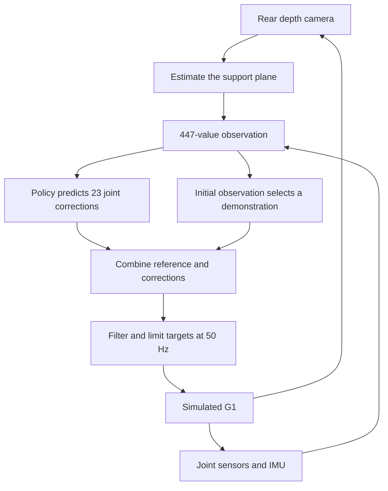

# Humanoid sitting and supported leaning

Can a Unitree G1 find a chair behind it, transfer weight onto it, and stay balanced? This project studies sitting and rear-supported leaning in Isaac Lab. A simulated rear depth camera locates the support. A whole-body controller coordinates 23 joints as the robot moves from standing into contact.

*Centered start in the box-armchair test. Gold marks the allowed contact patch and red shows the contact force. The controller held this lean for 6.84 seconds. [Three-start trial record](box_armchair_lean_20261104_v4/results/repeatability.json)*

## How the controller works

The November armchair policy combines a recorded demonstration with learned joint corrections. The same controller architecture supports evaluating the demonstration alone by setting those corrections to zero.

Three recent sensor frames describe the approach, including joint angles, speeds, motor effort, gravity and angular velocity. The policy also receives task intent, elapsed time and the initial sensor frame. Joint targets change by at most 0.003 radians per control step. During training, proximal policy optimization (PPO) updates the corrections. During evaluation, an independent scorer inspects the full 20-second trial for load, slip, contact location and balance. [Observation and control code](armchair_rest_trainer_20261105_v1/environment.py) · [Motion selection and residual policy](armchair_rest_trainer_20261105_v1/policy.py) · [Physical scoring](armchair_rest_trainer_20261105_v1/audit.py)

## What the trials showed

A clean rest requires at least five consecutive seconds of stable contact at the end, with the allowed support bearing at least 5% of bodyweight. A loaded slip earlier in the approach can still fail the trial, even if the final pose looks stable.

| Experiment | Standing-start result | Read the evidence |
| --- | --- | --- |
| Sitting on the 72 development cases | The frozen, sensor-selected motion library passed 64/72. After 256 PPO updates, the two seeds passed 30/72 and 16/72. Both left the eight original failures unresolved. | [Baseline](motion_prior_ppo_20261029_v2/RESULTS.txt) · [Completed comparison](task_pause_20261030_v1/pause_receipt.json) |
| Leaning on one box armchair | The camera-guided controller passed 3/3 from center and ±15 mm lateral offsets. Final holds were 6.82–6.84 s. | [Trial-by-trial measurements](box_armchair_lean_20261104_v4/results/repeatability.json) |
| Learning armchair corrections | On a separate set of 11 matched starts, the frozen reference passed 11/11 and the policy after 128 PPO updates passed 2/11. In the other nine, an ankle came too close to its joint limit before the chair took any load. | [Matched trials](armchair_rest_ppo_20261105_v1/results/comparison.json) · [Ankle diagnosis](armchair_rest_policy_video_20261105_v1/regression_diagnosis.json) |
| Holding and returning to standing | During narrow-support calibration, the G1 held for 10.86 s with about 55% of its weight on the support. One loaded-slip sample failed the trial. Ankle-velocity readings also prevented a sensor-qualified stand-up. None of the three requested sit–hold–stand cycles passed. | [20-second video](rest_cycle_load_validation_20261109_v1/results/narrow_support_load_calibration.mp4) · [Calibration record](rest_cycle_load_validation_20261109_v1/execution_receipt.json) · [Cycle status](validated_low_seat_contact_01/current_successor_checkpoint.json) |

## Where to look in the repository

| To understand… | Start here |
| --- | --- |
| How depth measurements become support features | [Support-surface tracker](ubuntu/sitting_task/src/humanoid_sitting/supported_surface.py) and [sensor and observation assembly](ubuntu/scripts/run_supported_transition.py) |
| How standing starts are planned for the armchair | [Camera-guided trial](box_armchair_lean_20261104_v4/trial.py), [motion plan](box_armchair_lean_20261104_v4/plan.py) and [frozen inputs](box_armchair_lean_20261104_v4/results/inputs.json) |
| How demonstrations become a trainable policy | [Demonstration preparation](armchair_rest_trainer_20261105_v1/prepare.py), [rewards](armchair_rest_trainer_20261105_v1/rewards.py) and [PPO training loop](armchair_rest_trainer_20261105_v1/run_training.py) |
| How the project estimates support load and investigates failed transitions | [Load observer](rest_cycle_load_validation_20261109_v1/observer.py), [ankle-readout test](native_contact_readout_20261109_v2/execution_receipt.json) and [contact-entry preparation](rest_cycle_contact_fix_20261109_v1/execution_receipt.json) |
| Where later chair-approach work lives | [CPU diagnostics](cpu_diagnostics/), including the [seat-plane approach](cpu_diagnostics/seat_plane_approach.py) and [braked touchdown evaluation](cpu_diagnostics/evaluate_preload_brake.py) |

Top-level experiment directories retain versioned source and compact evidence. The [Ubuntu snapshot](ubuntu/) contains the project-owned simulator scripts, task package and experiments. [Repository metadata](repository_metadata/) describes the imported sources and dependencies. [Repository tools](repository_tools/) contains the import and secret-screening tool.

## Runtime and artifacts

The linked trial records, code and video can be reviewed directly on GitHub. To reproduce a historical run, restore the pinned Isaac Lab checkout, robot and furniture assets, dataset, reference motions and checkpoints specified by that run. The original Ubuntu workspace used `/home/kadir/humanoid-sitting` and `IsaacLab/.venv/bin/python`. Many scripts still use absolute paths. Historical launch scripts assume that setup. The project's GPU allocation is the RTX 4090, with the RTX 4070 reserved for AIWorker. [Artifact inventory and restoration guide](ARTIFACTS.md) · [Runtime dependency revision](repository_metadata/runtime_dependencies.json)

## Repository history

The November 9, 2026 import grouped existing work by subsystem. Experiment timestamps, run records and hashes document the saved work. The [reconstructed saved-history branch](https://github.com/kadiru/humanoid-sitting-control/commits/reconstructed-saved-history/) groups 773 surviving records by folder label and local record number. Its final tree matches the seven-commit import of 24,267 files. The original global edit order and authorship cannot be recovered from that archive. [Reconstruction inventory](repository_metadata/reconstructed_history.json)

## Commit practice

Commit and push at meaningful, validated milestones: a bug fixed, a technical
obstacle resolved, or a feature ready. Group the related edits into one commit;
do not commit each attempt, intermediate step, or saved record. This supersedes
the earlier practice of committing and pushing every individual change.

Stage changed source files explicitly, together with necessary tests and runtime
configuration. Include documentation only when needed to use the changed code.
Keep routine research notes, status reports, outcome receipts, logs, videos,
generated results, and failed-attempt evidence locally; preserving evidence does
not require uploading it to GitHub. Summarize validation in the commit message
instead of adding a receipt. Do not use blanket staging for this workspace.

Use no more than ten meaningful commits per active workday, usually fewer; this
is a ceiling, not a target. Do not create more reconstructed record-by-record
history. Do not add credentials, environments, bulk trajectories, or generated
solver matrices to ordinary Git history.
