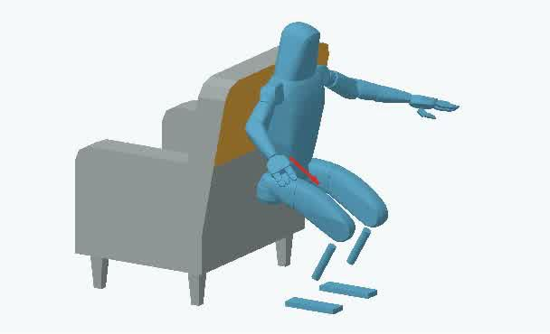
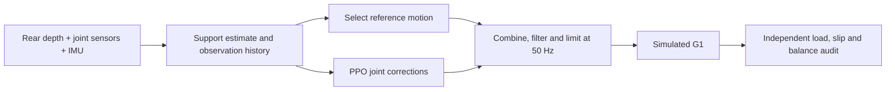

# Teach a humanoid to rest.

Sitting is a controlled transfer of weight. A robot must find the support behind it, approach without slipping, make the right contact, and remain balanced as the chair takes load.

This project studies **Unitree G1 sitting and supported leaning in Isaac Lab**, using a simulated rear depth camera and coordinated control of 23 joints.

*Camera-guided armchair lean: 6.84 seconds of stable hold from this centered start. [Three-start record](box_armchair_lean_20261104_v4/results/repeatability.json) · [Watch the development film](https://vimeo.com/kadiru/demo-humanoid-sitting-leaning). All results here are simulation.*

## What the work has established

| Published checkpoint | Result | What it means |
| --- | --- | --- |
| Sitting, 72 development cases | Reference motion library **64/72**; two PPO seeds **30/72** and **16/72** | Learning regressed against the reference on this set. [Comparison](task_pause_20261030_v1/pause_receipt.json) |
| Camera-guided box-armchair lean | **3/3**, from center and ±15 mm; holds **6.82–6.84 s** | Repeatable in a narrow tested neighborhood. [Measurements](box_armchair_lean_20261104_v4/results/repeatability.json) |
| Learned armchair corrections | Reference **11/11**, PPO **2/11** after 128 updates | Ankle-limit failures appeared before support took load. [Matched trials](armchair_rest_ppo_20261105_v1/results/comparison.json) |
| Complete sit–hold–stand cycle | **0/3** requested cycles | A stable-looking final pose is insufficient; loaded slip and stand-up qualification remain issues. [Cycle status](validated_low_seat_contact_01/current_successor_checkpoint.json) |

These are selected dated checkpoints, not a pooled success rate or a claim of general sitting autonomy. Newer [CPU diagnostics](cpu_diagnostics/) continue investigating approach and contact. The [experiment guide](docs/EXPERIMENT_GUIDE.md) preserves the protocols and limits behind the table.

## The central idea

Combine a sensor-selected demonstration with bounded learned corrections, and judge the complete transition with an independent physical scorer.

The project contributes task and observation design, reference-motion and residual-policy integration, and contact-aware evaluation. The G1 and Isaac Lab are external platforms. A clean rest requires five consecutive seconds of stable final contact, at least 5% bodyweight on the allowed support, and a valid approach; an earlier loaded slip can fail the entire trial.

## Read the code

| Follow the system | Entry point |
| --- | --- |
| Depth → support geometry | [Support-surface tracker](ubuntu/sitting_task/src/humanoid_sitting/supported_surface.py) |
| Geometry → armchair approach | [Trial](box_armchair_lean_20261104_v4/trial.py) · [Motion plan](box_armchair_lean_20261104_v4/plan.py) |
| Demonstration → trainable corrections | [Policy](armchair_rest_trainer_20261105_v1/policy.py) · [PPO loop](armchair_rest_trainer_20261105_v1/run_training.py) |
| Motion → a defensible result | [Independent audit](armchair_rest_trainer_20261105_v1/audit.py) · [Load observer](rest_cycle_load_validation_20261109_v1/observer.py) |

## Review or reproduce

Start with the [matched trial JSON](armchair_rest_ppo_20261105_v1/results/comparison.json) and [ankle regression diagnosis](armchair_rest_policy_video_20261105_v1/regression_diagnosis.json); both are readable without a GPU. Reproduction needs the matching Isaac Lab revision, robot/furniture assets, reference motions and checkpoints. Historical launch scripts contain Ubuntu workspace paths and are not a portable one-command install.

[Artifact restoration](ARTIFACTS.md) · [Pinned runtime dependencies](repository_metadata/runtime_dependencies.json) · [Detailed experiment guide](docs/EXPERIMENT_GUIDE.md)

## Next milestone

Complete a sensor-qualified sit–hold–stand cycle from standing, then show that learned corrections improve on the frozen reference across matched unseen starts. Keep load, slip, joint limits and failures in the comparison.

[Repository history and commit practice](docs/EXPERIMENT_GUIDE.md#repository-history)
